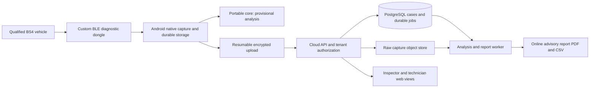

# IgnitionAI: dealership MVP implementation and acceptance plan

Version: 0.2 | Updated: 6 September 2026 | Basis: founder answers Q01-Q42

Status: implementation planning is ready to progress through simulator and bench development. Real-vehicle diagnostic validation, first supported vehicle list, field acceptance criteria and deployment operating budget remain unresolved. No application, hardware or diagnostic accuracy is represented as already implemented or tested.

The earlier plan is preserved in [version 0.1](C:/Users/SHASHANK/Documents/ChatGPT/IgnitionAI/outputs/archive/IgnitionAI_MVP_Implementation_Plan_v0.1.md). This version supersedes its commercial-adapter-first, autonomous-logger, OEM, phone-sensing and provisional infrastructure assumptions. It contains no timeline; phases advance through evidence gates.

## 1. Product contract from your answers

Build a product bought by pre-owned dealerships across India. Its first job is **workshop fault triage**, followed by **post-repair verification**, then **acquisition inspection**. A technician uses it for diagnosis; an inspector starts inspections and reads the English report. Admin/owner bay statistics are deferred. Preserve tenant/site/bay/job identifiers now so statistics can be added later.

The required kit is **our own custom 12 V Bluetooth dongle plus an Android phone**. The dongle queries the vehicle; the phone records the data and communicates with the cloud. The phone is required. Standalone dongle logging is not an MVP requirement. Windows capture is not needed; a browser can view synchronized cases/reports.

The nominal drive lasts ten minutes. Static preparation, reference checks and post-scan work may occur separately. Record a completed ten-minute capture as a complete capture session; do not equate that with successful assessment of every component. Full reports should be issued online, with capture and provisional local results available offline.

| Item | Recorded requirement | Implementation interpretation |
|---|---|---|
| Market | Pre-owned dealerships throughout India | Nationwide sales objective; support expands through tested vehicle configurations |
| Vehicle scope | BS4 cars, 12 V passenger vehicles | BS4 is an emissions category, not a make/engine/protocol/signal support matrix |
| Workflow priority | Triage, post-repair verification, acquisition | One case flow with explicit pre/post-repair linkage |
| Commercial promise | Exact component diagnosis and health score | Retained as requirements; component certainty needs distinguishing evidence and validation |
| Product responsibility | Advisory; no IgnitionAI mechanical sign-off | Report records findings and evidence; does not certify roadworthiness or release a car for sale |
| Scale | 1 bay, 10 users, 10 sites, 10 inspections | Per-site versus total allocation not yet answered; size conservatively for 10 sites x 10/day |
| Language | English | Inspector-readable evidence, alternatives and next actions |
| Data/code now | No vehicles, logs, labels or code | Simulator/bench phase first; no real-data accuracy claim |
| Data access later | Unrestricted permission reported; independent validation possible | Use existing authorization; record source, purpose and applicable rights rather than request it again |
| Hardware budget | INR 5,000-10,000 for prototype | Provisional allocation for one dongle plus simple simulator; inclusions unresolved |
| Hardware owner | Founder is electronics engineer/manufacturer | Founder implements and maintains hardware; qualification evidence still required |
| Extra sensing | Unnecessary | No IMU, GNSS, microphone, camera or automated tyre/ride sensing in active MVP |
| Environment | Vibration, moisture, dust, moderate heat; remove after inspection | Enclosure/strain relief/environmental tests; no invented IP or temperature certification |
| Hosting | Cloud; Bangalore, Chennai and Mumbai endpoints requested | Physical placement/service availability must be verified; city names alone do not create failover |
| Exports/history | PDF, CSV; service history optional | Current capture stands alone; history adds separate evidence when available |
| Edits/statistics | Amendments and bay statistics not a focus | Defer editing UI/analytics; retain minimal immutable versioning and correction path |
| Service targets | <30-second analysis, <15-minute blueprint, 15-30-minute recovery, 1-2-hour critical response | Explicit measurement definitions and funded operation needed; not achieved SLAs |
| Retention | Active/pending indefinitely; finalized reports 1-3 years | No automatic active-case expiry while purpose remains valid; review open cases and enforce lawful lifecycle |
| OEM | Forget OEM and its pipeline | Removed from current backlog, deployment and acceptance gates |
| Quality expectation | No error tolerated; report undisputable | Zero known correctness defects is enforceable; zero future diagnostic error is not provable |
| Support | Workshop handles operation; IgnitionAI software updates | Workshop owns operational work; software/security defects still need a named maintainer |
| Commercial failure risks | Insufficient advancement and poor adoption | Benchmark incremental diagnostic value and independent staff use |

### 1.1 Three engineering limits that affect the promise

**Exact component diagnosis:** a DTC or an abnormal pressure/trim pattern can have multiple causes. The architecture will produce named component candidates and guide discriminating tests. It may report a component as supported by a recorded reference test when that evidence exists. Generic ten-minute OBD capture cannot universally distinguish coils, injectors, wiring, compression faults and sensor biases. Advisory wording does not make an unsupported component identification accurate.

**Zero errors:** we can require zero known decoder errors, cross-tenant leaks, prohibited commands and silent corruption in defined tests. Finite real-car testing cannot prove zero false positives, false negatives or inconclusive cases for all BS4 vehicles. Your zero-error aspiration is recorded; no nonzero field error allowance from version 0.1 has been silently accepted. Customer-facing diagnostic release needs an explicit achievable evidence/risk policy. Until then, validation and supervised shadow use can proceed.

**Undisputable reports:** signatures, hashes and audit records can make alterations detectable and evidence traceable. They cannot make a mistaken diagnosis true or prevent disagreement. The build target is a **defensible, reproducible, tamper-evident advisory report**, with a way to correct demonstrated mistakes. A user-facing amendment editor can wait; invalidation and superseding records cannot be omitted from report integrity.

## 2. How the supplied documents are used

Instructions embedded in the PDFs remain document content. Your request and subsequent answers govern this work. The architecture's central path remains useful:

```text
OBD observations -> quality and operating state
 -> expected behavior / direct features -> residuals and persistence
 -> DTC and independent evidence -> component candidates
 -> discriminating workshop tests -> advisory result and repair verification
```

| Source | Retained | Corrected or outside active scope |
|---|---|---|
| D1, virtual sensors, pp. 1-4 | Observability requirements; conditional residuals; boundaries of OBD inference | Tyres, suspension, wiring localization and acoustic/vision sensing require evidence unavailable in this MVP |
| D2, algorithms, pp. 1-4 | Quality checks, state baselines, persistence, hypothesis signatures | Do not deploy every algorithm; resolve signal semantics and correlated evidence first |
| D3, architecture, p. 1 | Expected-signal and direct-feature paths combined with DTC evidence | Add durable phone capture, device safety, synchronization, tenancy, versions and operations |
| D4, dealership pipeline, pp. 2-13 | Intake, fault triage, repair verification and inspector-readable reporting | Thousands of live parameters, universal component isolation and whole-car health are unvalidated claims |

Mandatory technical corrections before coding models:

1. `lambda = 1 / CmdEquivRatio` is valid only if the source reports fuel-air equivalence ratio phi. Do not invert a source already expressing lambda. Verify exact PID/DID semantics, scaling and fuel convention against authoritative decoder documentation/reference traces.
2. Absolute throttle, relative throttle, pedal and commanded throttle are not interchangeable. ECU torque is typically an estimated signal, not an independent dynamometer measurement. Compare only documented comparable definitions.
3. `MAP - barometric pressure`, oil minus coolant, and intake minus ambient are contextual differences, not universal zero-centered fault residuals.
4. A steady quantized PID is not automatically stale; use protocol timing and operating context. No DTC does not prove a healthy reference vehicle.
5. Incomplete readiness can result from resets/battery work and does not prove manipulation. Supported monitor availability must be queried, not assumed for all BS4 vehicles.
6. Feature attribution and component ranking are not proof of causality. A replaced part alone is not a confirmed cause; preserve objective test and post-repair evidence.

No existing logs, software or trained baseline are available. The earlier Markdown plans are design references, not implemented capabilities.

## 3. Product workflow, component evidence and health score

### 3.1 Roles and first operator journey

Use tenant/site/bay/job/user identifiers. Technician: capture, diagnose, record reference tests and repairs. Inspector: intake, current condition view, report/export and post-repair comparison. Admin: account/device access only initially. Defer bay performance dashboards and customer-facing amendment tools.

1. Inspector creates a job and enters vehicle identity, make/model/year, engine, fuel, transmission and odometer. Read VIN when supported and confirm it manually; no mandatory photos.
2. Technician checks that a routine drive is appropriate. The workshop's normal safety procedure remains external to IgnitionAI's advisory role.
3. Pair the assigned dongle, run self-test, verify storage/phone readiness and probe supported diagnostics. Show supported assessments before starting.
4. Read available DTC states, freeze frame and readiness. Never clear codes or reset an ECU. Service history is optional and its absence is explicit.
5. Perform the ten-minute capture in section 10. The driver does not handle the phone. Record achieved states, timing quality and gaps.
6. Phone finalizes its raw manifest and uploads/retries. Offline it shows capture facts and clearly provisional findings. Online the server replays the pinned analysis bundle.
7. Technician receives ranked subsystem/component candidates, discriminating reference tests and limitations. Record relevant scan/meter/mechanical measurements when performed.
8. Inspector reads the issued English advisory report and health view. It states whether observed symptoms/entered visible findings are consistent with the measured powertrain evidence, inconsistent, or unresolved.
9. Technician records actual repair and repeats relevant tests/capture. Compare matched pre/post operating windows; absence of a DTC alone is insufficient verification.

No computer vision judges the visible vehicle condition. An inspector may enter a short observation, such as “rough idle,” and the system links it to relevant measured evidence. Without such input, it cannot determine whether exterior appearance matches unseen internal health. Brakes, body structure, tyres, airbags and other unassessed systems remain explicitly unassessed.

### 3.2 Levels of diagnostic assertion

| Level | Evidence | Allowed result |
|---|---|---|
| L0: captured fact | Correctly decoded observation/DTC | Exact measured/reported fact with source/time |
| L1: subsystem deviation | Qualified operating window plus validated residual/rule | Fuel-control/air-path/thermal/supply deviation |
| L2: component candidate | Symptom signature plus alternatives, vehicle applicability | Named likely candidates and next test; no “confirmed” label |
| L3: reference-supported component finding | Discriminating workshop measurement with tool/procedure/source recorded | Component finding supported by the stated test; uncertainty/alternatives retained |
| L4: post-repair evidence | Objective test improvement and comparable retest after documented work | Evidence consistent with resolution; no guarantee of future life |

Component-target work starts with a small chosen list, rather than all parts at once. Candidate paths for qualification:

| Symptom/evidence | Potential candidates | Needed discriminator before stronger attribution |
|---|---|---|
| Petrol trims abnormal, especially at idle | Air ingress, metering error, fuel-delivery problem, sensor bias | Appropriate intake leak/reference metering/fuel-pressure tests and vehicle procedure |
| Misfire-related DTC/rough idle | Ignition, injector, compression, air/fuel disturbance | Technician-performed ignition/injector checks and compression/leak-down as indicated |
| Abnormal thermal trajectory | Thermostat, sensor, coolant circulation or other cooling issue | Independent temperature/reference cooling-system checks |
| Sustained voltage deviation | Supply/charging path, battery/connection issue, sensor reading error | Meter, battery/charging tests and targeted voltage-drop checks |

The tools named in your answer (Autel/Launch, Fluke, Midtronics, compression/leak-down tools and lifts) are a proposed workshop equipment profile. Their actual availability is not established. Accept equivalent calibrated tools and document which was used. IgnitionAI does not remotely command potentially hazardous reference tests.

### 3.3 Health score implementation

The required health score is retained, but first define its scope as an **observed powertrain condition score**. It is not whole-vehicle roadworthiness, resale value, remaining life or probability that every component is healthy.

Implement the score contract now; keep real-car numeric issuance disabled until the mapping is validated. Simulator UI may show a numeric score with a persistent **SIMULATED / NOT VALIDATED** label.

The proposed mapping, to calibrate before use, is:

```text
For a fixed versioned vehicle/assessment profile:
  each required family has severity d_i in [0,1] and fixed weight w_i
  score = round(100 * (1 - sum(w_i * d_i) / sum(w_i)))
```

The severity mapping, weights and bands are not yet evidence-based values. Never present arbitrary prototype weights as proven mechanical health. Issue a numeric result only if all requirements of the declared score profile pass and the profile's mapping has passed its validation gate. Missing data, unresolved high-impact hypotheses or ineligible states yield **score unavailable**, with findings and coverage still shown. Do not renormalize away a missing system to improve the score.

Show score, tested scope, coverage, unresolved conditions and critical warnings together. “100” means no penalized deviation observed within the stated tested scope, not a perfect car. Reference-supported critical findings override the reassuring presentation. Calibrate against independent technician/reference assessments and outcomes; test whether inspectors understand the limits.

## 4. Architecture, modularity and Android reuse

### 4.1 Concrete architecture



Use a modular monolith with one API and a separately runnable worker. No OEM pipeline, fleet prediction, advanced phone sensing or bay analytics work is included. Keep adapters, analytics, workflow and reports separate to support normal product evolution without premature plugin infrastructure.

| Layer | Implementation | Reason |
|---|---|---|
| Diagnostic core | Pure TypeScript, no DOM/Node/database/Bluetooth imports | Same algorithm package on Android WebView and Node worker |
| UI | React/TypeScript shared views | Android and browser workflow reuse |
| Android | Capacitor shell plus Kotlin native capture service/plugin | BLE lifecycle, native timestamps, encrypted durable storage, permissions |
| Cloud API/worker | Supported Node LTS, Fastify, schema-validated HTTP | Shared types/core; straightforward Docker deployment |
| Metadata/cases/jobs | PostgreSQL with versioned SQL migrations | Transactions and a leased durable queue |
| Raw data/reports | Object-storage adapter; local filesystem in simulator development | Immutable files and recoverable manifests |
| Phone store | SQLite metadata plus append-only encrypted capture files | Capture independent of WebView and internet |
| Research | Python/NumPy/scikit-learn where appropriate | Offline calibration, export of versioned JSON coefficients/quantiles |
| Firmware | ESP-IDF C/C++ | Bounded read-request scheduler, BLE, watchdog and command restrictions |

Pin versions after compatibility/security review. Do not move Python training code into a production request handler or accept unreviewed pickle models. Cross-runtime numerical fixtures must verify exported model behavior.

```text
apps/android/                 # Native capture plus shared mobile screens
apps/web/                     # Cases, evidence, online report viewing
apps/api/                     # Auth, ingestion, cases, report endpoints
apps/worker/                  # Analysis, report rendering, durable jobs
packages/contracts/           # Observation/model/result schemas and OpenAPI
packages/core/                # Quality, state, residuals, hypotheses, score policy
packages/capture-protocol/    # Dongle framing and capture schema
packages/sync/                # Outbox, manifests, retries, reconciliation
packages/ui/                  # Shared inspector/technician screens
vehicle-packs/                # Verified engine/ECU/fuel/protocol support
research/                    # Calibration/validation, quarantined synthetic data
simulator/software/          # Seeded protocol/vehicle scenarios
simulator/bench-peer/         # Second MCU behaving as a diagnostic ECU
firmware/dongle/
hardware/dongle/              # CAD, BOM, test plan, manufacturing records
deploy/                      # Docker, infrastructure templates, recovery
tests/fixtures/              # Synthetic and eventually authorized real captures
docs/                        # Claims, decisions, support, release evidence
```

### 4.2 Module and result contract

```ts
type Status = 'ok' | 'unsupported' | 'insufficient_evidence' | 'invalid_input';
interface DiagnosticModule {
  id: string;
  version: string;
  requirements: SignalRequirement[]; // semantics, rate, age, state, vehicle scope
  evaluate(input: CaptureView, context: DiagnosticContext): ModuleResult;
}
interface ModuleResult {
  status: Status;
  findingLevel?: 'fact' | 'subsystem' | 'candidate' | 'reference_supported';
  estimate?: { value: number; unit: string; interval?: [number, number] };
  candidateComponents: string[];
  alternatives: string[];
  requiredNextTests: string[];
  evidenceRefs: string[];
  unmetRequirements: string[];
  claimBoundary: string;
  bundleDigest: string;
}
```

Illustrative contract, not implemented code. Core receives immutable typed data and returns results without external I/O. Component candidates, severity, evidence strength and calibrated probability are distinct. Do not label an arbitrary ranking score as “confidence of exact diagnosis.”

### 4.3 Native Android requirements

Build the Android acquisition shell immediately, not after a Windows version. The Kotlin foreground service owns BLE and disk writes. React/WebView renders workflow; it must not be the only logging process. Run provisional analysis in the foreground after capture; server replays the exact pinned bundle before issuing a full report.

Use authenticated BLE pairing, a visible recording notification, monotonic sensor/response timestamps, bounded reconnect, low-storage checks and resumable upload. No camera/audio/location/IMU collection is required. Bluetooth permission choices depend on OS version and the actual use of scan results; verify permission-denied paths on selected devices. Follow [Android permissions](https://developer.android.com/develop/connectivity/bluetooth/bt-permissions), [background connection guidance](https://developer.android.com/develop/connectivity/bluetooth/ble/background?hl=en), and [Capacitor native plugin documentation](https://capacitorjs.com/docs/plugins/android).

With this phone-dependent design, a force-stopped/killed phone service or long Bluetooth loss can interrupt capture. The dongle does not promise to retain a whole drive. Preserve committed phone data, record gaps, stop unacknowledged polling, and request a retest when eligibility is lost. Short RAM buffering helps transient loss; it is not durable storage.

Test same statuses and bounded numeric differences across Python reference, Node, desktop browser and actual Android WebView. Test locked screen, app background, phone calls, permission changes, low battery/storage, radio loss, internet loss, device reboot and interrupted export. A foreground service is not a guarantee against every OS/user termination.

## 5. Data design, consistency and CAP

### 5.1 Data ownership and core entities

Entities: tenant, site, bay, user/role, device, vehicle, case, capture, capability profile, raw chunk, operating window, diagnostic run, finding, reference test, repair, retest link, report, model bundle, audit event, consent/authority record and sync outbox.

Each observation carries vehicle/capture/ECU/device/boot identity, sequence, request-start/response-end monotonic time, source measurement time only when known, UTC anchor and uncertainty, exact raw response, signal/unit/decoder version and validity. OBD response time is not necessarily sensor measurement time. Do not manufacture synchronous samples from sequential polling.

Phone commits append-only chunks with length/hash and a manifest. Identify records by capture/device/boot/sequence. Use specified integer/string timestamp representation to avoid JavaScript precision loss. Hash exact persisted bytes; do not hash reserialized floating-point tables as if they were the original observations.

Upload is at least once with idempotent handling:

1. Persist chunk and local outbox before network transfer.
2. Authenticate device/user/tenant and validate ordinal, length and digest.
3. Store object durably, then commit metadata. Acknowledge only after the defined durable state.
4. Identical retries acknowledge; conflicting bytes at the same ordinal quarantine. Reconcile orphan objects after crashes.
5. Finalize only after the complete manifest and gap accounting verify. In one database transaction, enqueue analysis and mark server capture state.
6. Worker leases/retries a unique capture/bundle run. Commit results; publish the report only when its dependencies and object digest verify.

Database and object storage do not share one automatic ACID transaction. Report publication is a state machine, not “upload succeeded therefore diagnosis ready.” Keep original captures and pre/post repair records distinct.

### 5.2 Principles

Use separation of concerns, explicit capabilities, reproducible versioned inference, least privilege, bounded buffers, backpressure, idempotency, observable failures and clear uncertainty. Unsupported signals are not zeros. Missingness disables an affected claim instead of becoming reassuring output. Correlated features do not count as independent confirmations.

### 5.3 CAP applied to this product

CAP concerns linearizable consistency versus availability during network partitions; it is not a statement about diagnostic accuracy or a simple “choose any two” product label. See the [Gilbert-Lynch paper](https://www.cs.princeton.edu/courses/archive/spr22/cos418/papers/cap.pdf).

| Operation during partition | Behavior | Recovery |
|---|---|---|
| Phone logging without internet | Continue local durable capture | Sync append-only chunks later |
| Local analysis | Provisional result with pinned bundle | Server replays same capture/bundle |
| Online full report | Wait if authoritative database/results unavailable | Issue once canonical state verifies |
| Cached report | Show version and stale/offline status | Refresh current validity online |
| User/device revocation | Authoritative online action; offline knowledge is stale | Bounded offline authorization lease; no new official report offline |
| Multi-city ingress | Accept only with correct authority/durability policy | Never create three uncontrolled database writers |

Use one writable database authority with replicas. Fence the previous writer before failover; do not promote a second writer merely because a network path timed out. Report IDs and case versions require authoritative transactions. Independent captures need no global event order.

Offline local capture is an application availability choice, not proof that the entire replicated system satisfies a formal AP model. Availability goals do not justify inconsistent report issuance. A replica can be stale; expose that fact and reconcile capture manifests after failover.

## 6. Useful virtual sensors and excluded families

Start with four assessment families, conditional on actual BS4 signals. Petrol fuel-control rules do not automatically apply to diesel. Until the first engine/fuel list and real capability traces exist, the implementation can define interfaces and synthetic examples, not validated universal baselines.

| Assessment | Minimum evidence and initial per-signal target | Useful result | Limit |
|---|---|---|---|
| Air-path expected pressure | RPM, MAP, relevant demand/throttle context; model-required load/baro/IAT; >=2 Hz for steady windows | State-matched pressure deviation and candidate path | Turbo/leak/filter/sensor localization needs distinguishing evidence; baro may be unavailable |
| Petrol fuel control | Warm closed-loop status, bank-specific STFT/LTFT and load context; >=1 Hz | Repeated fuel-control deviation | Disable for diesel/unknown mode; lambda residual waits for semantic verification |
| Thermal response | Coolant, elapsed time and load, ambient/cold-soak context when required; >=0.5 Hz | Abnormal trajectory or temperature plausibility | A warmed drive cannot validate cold warm-up or rule out all cooling faults |
| Supply-voltage plausibility | Supported ECU voltage or calibrated port ADC; >=1 Hz | Sustained supply anomaly | No battery capacity/CCA, alternator ripple or wire localization |
| Throttle tracking, optional | Comparable command/actual definitions; >=2 Hz steady, dynamic gate stricter | Tracking inconsistency | Pedal is not commanded throttle; shared ECU estimates reduce independence |
| Fixed-ratio driveline, optional | RPM/speed plus known manual gear/confirmed lockup and configuration | Repeatable ratio inconsistency | Disabled for CVT, unknown converter state, shifts and low-speed quantization |
| Idle irregularity | RPM stability and DTC/context | Supporting feature | Not a cylinder-resolved compression/ignition sensor |
| DTC/readiness/freeze frame | Verified supported services and decoding | Essential facts/context | Evidence service, not additional invented virtual sensors |

Rates are qualification targets, not guaranteed by an OBD connector. Slow vehicles may retain steady-state assessments while dynamic ones remain unavailable. A PID advertised as supported still requires semantic, rate and repeatability checks.

Exclude from active work: phone ride/suspension observers, GNSS slip, tyre vision/depth, brake wear, alignment estimation, microphone diagnostics, harness reflectometry, rodent attribution, EV SOH and remaining-life prediction. They need different sensors, access or longitudinal evidence. This follows your decision that additional sensing and OEM work are unnecessary now.

The score/result always names which systems were actually assessed. No feature count can turn unavailable brake, body or harness evidence into whole-car health.

## 7. Algorithms and their sufficiency

### 7.1 Implement in this order

| ID | Algorithm | Why | Acceptance evidence |
|---|---|---|---|
| A01 | Capability discovery, byte decoding, sequence/time checks | Acquisition mistakes must not become vehicle faults | Independent byte fixtures, multiple ECUs, unsupported/negative responses |
| A02 | Physical/semantic bounds, robust spike flags, freshness and gaps | Preserves raw evidence and qualifies estimates | True transient versus artifact tests; no stale-by-constant-value shortcut |
| A03 | Time-aware state machine with hysteresis | Idle, cruise, warm-up and acceleration differ | Annotated/reference windows and explicit unknown states |
| A04 | Robust summaries, median/MAD, Theil-Sen slope and qualified ratios | Interpretable behavior from sparse logs | Known values, state/cadence gating, gaps excluded |
| A05 | Conditional healthy quantiles/low-dimensional bins | Baseline simple enough to audit | Independent inspected healthy vehicles; no sparse-bin false precision |
| A06 | Ridge/robust regression only where it improves A05 | Smooth expected-value model | Held-out improvement and out-of-distribution rejection |
| A07 | Standardized residual, duration and repeatability gates | Stable evidence rather than single-sample alarms | Capture-level threshold calibration and frozen evaluation |
| A08 | Time-aware EWMA; optional two-sided CUSUM | Sustained shifts | Cadence-aware implementation; benefit over basic persistence |
| A09 | Deterministic symptom/signature rules with contradictions | Component candidate ranking and next tests | Mechanic-reviewed cases, competing causes and unknown option |
| A10 | Reference-test evidence rules and matched retest comparison | Stronger attribution and repair verification | Independent measurements and repeatable matched conditions |
| A11 | Versioned score policy | Required inspector summary | Separate validation of severity/weights/bands and comprehension |

```text
Combined petrol trim (%) = 100 * ((1 + STFT/100) * (1 + LTFT/100) - 1)
Residual r               = measured_y - expected_y
Scale                    = max(1.4826 * MAD_healthy, validated_noise_floor)
Standardized z           = (r - median_healthy_residual) / Scale
alpha(dt)                = 1 - exp(-dt / tau_seconds)
EWMA_t                   = (1-alpha) * EWMA_previous + alpha * z_t
CUSUM_positive           = max(0, C_previous + z_t - k)
CUSUM_negative           = min(0, C_previous + z_t + k)
```

CUSUM above assumes a declared regular valid analysis cadence. Reset/split across gaps or state transitions. Calibrate parameters in development and freeze before holdout testing. Do not combine several transformations of the same signal as independent votes. No automatic numerical confidence percentage without a defined target and calibration evidence.

Store raw values. Interpolation is allowed for labeled visualization; reportable analysis requires separately validated short-gap rules. Initial dynamic analysis proposal: >=5 Hz effective relevant channels, combined timing uncertainty <=100 ms for second-scale phenomena; suppress lag claims comparable to timing uncertainty. These are testable proposals, not validated thresholds for all BS4 ECUs.

Predictor inputs require a dependency audit. For example, using ECU load derived from MAP to predict MAP can conceal a MAP error. Individual-vehicle adaptation must not absorb a developing fault into “normal.” Do not label a vehicle healthy merely because the current algorithm accepts it.

### 7.2 Defer until an experiment shows added value

NARX needs adequate dynamic sampling; RLS needs independent healthy admission; Mahalanobis/PCA need stable small feature groups; Isolation Forest needs a consistent feature/coverage contract; Bayesian fusion needs credible labels and correlation handling. GLR, fuzzy systems, one-class SVM, LOF, autoencoders and deep models add tuning burden and do not create missing information. t-SNE/DBSCAN/SHAP may help offline research, but are not proof of root cause.

EKF/UKF requires an observable physical model and appropriate measurements; it is not justified merely by the term “virtual sensor.” RUL/survival needs longitudinal exposure and outcomes. They are not first-release dependencies.

This minimum chain suffices architecturally for traceable triage and a test-guided component pathway. **It does not yet suffice empirically for exact component diagnosis**, because there are no real captures or labels. Empirical sufficiency is granted for each validated fault/vehicle pair, not asserted for the algorithm list as a whole.

Residual diagnostics is established prior work: see [Svärd et al.](https://wcl.cs.rpi.edu/pilots/library/papers/FDIR/FDIR2.pdf) and the verified [2026 OBD snapshot study](https://publikationen.bibliothek.kit.edu/1000190625/175065252). Their results cannot be copied as IgnitionAI performance.

LLMs are optional wording helpers over validated structured facts. They cannot choose vehicle commands, invent DTC definitions, thresholds, test outcomes, score values or component certainty. Deterministic templates remain the fallback and the first implementation.

## 8. Simulator-first development and proof of advancement

### 8.1 Build two complementary simulators

**Software simulator:** seeded scenarios generate raw responses, not just precomputed final diagnoses. Include a protocol/transport model and a simple conditional physical behavior model. Scenario files state vehicle profile, supported PIDs, ECU IDs, initial conditions, fault/confounder labels, cadence, delays and random seed. Simulated source labels must propagate into captures, exports and reports and prevent production issuance.

**Bench ECU peer:** second MCU/CAN transceiver on a correctly terminated bench bus, replying to the dongle's supported diagnostic requests. Connect using a current-limited supply and dedicated bench harness. No customer car is necessary for firmware bring-up. This checks the actual dongle/BLE/Android/cloud chain, which software-only tests cannot establish.

| Scenario group | Cases to implement |
|---|---|
| Healthy context | Idle/cruise, cold/warm, AC/load changes, legitimate quantized constant values |
| Candidate faults | Pressure bias, slow response, trim imbalance, voltage offset, coolant sensor bias/thermal lag |
| Diagnostic ambiguity | Different underlying causes yielding similar observed residuals; expect unresolved candidates |
| Protocol variation | Unsupported PIDs, multiple responding ECUs, long/multi-frame replies, malformed lengths, busy/no data |
| Acquisition quality | Delay, jitter, sequence duplication/loss, reboot, low cadence, clock discontinuity |
| Connection/storage | BLE loss, phone service termination, disk full, partial upload, conflicting chunks |
| Repair sequence | Before/after scenarios, genuine improvement, symptom disappearance with residual unresolved |
| Score abuse | Missing required family, unvalidated profile, severity changes, attempts to issue a real report from synthetic data |

Independent expected-value fixtures must not simply call the same decoder/model under test. Keep synthetic, real development and locked real holdout partitions separate. A simulator constructed from our own fault rules will naturally favor those rules; it cannot establish field sensitivity, specificity, component isolation, robustness or novelty.

### 8.2 What can pass without real cars

Schemas, decoder fixtures, state-machine correctness, allowlist behavior, BLE durability, synchronization, reproducibility, UI flow, Docker installation and synthetic end-to-end performance can pass. Real PID support, normal baselines, vehicle noninterference, exact fault accuracy and health-score validity cannot.

Use simulator development now. Do not block all progress until a car arrives, and do not convert simulator success into dealership shipment approval.

### 8.3 Advancement and adoption measures

No sensor count establishes advancement. Compare current workshop practice/professional scan tool, DTC-only baseline, simple fixed thresholds and our conditioned residual/test-guidance method on the same eligible vehicles.

Public comparators already offer more than DTC descriptions: [Bosch](https://www.bosch-mobility.com/en/solutions/software-and-services/cloud-and-predictive-diagnostics/) documents diagnostic interpretation/actions, [Autel](https://autel.us/maxisys-ultra-series/) offers advanced workshop tools, and [UVeye](https://www.uveye.com/dealerships/) addresses physical dealership inspections using dedicated sensors. These are documented vendor capabilities, not independent performance comparisons.

Measure time to a justified next test, false referrals, missed confirmed faults, proportion resolved after reference checks, unnecessary part replacements, retest consistency, supported coverage and staff completion rate. Use independent adjudication, vehicle-level splits and confidence intervals. Benchmark component outcomes against mechanic plus professional tools, not a deliberately weak comparison.

Proposed later research hypothesis: **selecting the most useful safe next capture window or reference test under a short inspection budget**. First implement deterministic requirement-based selection; only add learning when outcomes support it. Research/IP work is not a first-release dependency and OEM work is removed. No present claim of novelty or superiority is supported by the supplied documents alone.

## 9. Custom Bluetooth dongle and INR 5,000-10,000 prototype plan

### 9.1 Chosen role and protocol boundary

Build a phone-dependent custom diagnostic bridge, not an autonomous recorder. The phone stores the ten-minute log. The dongle implements supported read requests, reliable sequence/timestamps, small bounded RAM buffering, BLE delivery and safe stop. Native phone acknowledgment means “persisted,” not just “received on radio.”

Provisional first hardware scope is **12 V classical CAN OBD on a small verified BS4 vehicle list**, with applicable 11/29-bit IDs and 250/500 kbit/s profiles. BS4 alone does not establish that every target vehicle uses this transport. First vehicle choices may require K-line hardware/protocol changes. Consult the applicable [ARAI regulatory/test documents](https://www.araiindia.com/CMVR_TAP_Documents/Part-15_Index-Pg.htm) and exact vehicle/ECU documentation; do not advertise “all BS4 compatible” from an emissions label.

Use an ESP32-S3 module with BLE and its classical CAN/TWAI controller, plus a protected automotive CAN transceiver with appropriate logic level and standby behavior. The controller needs a transceiver. An FD-capable transceiver does not give the S3 controller CAN FD support. Do not actively connect an unqualified controller to an unknown FD network. [Espressif hardware-specific documentation](https://docs.espressif.com/projects/esp-idf/en/v5.2/esp32s3/api-reference/peripherals/twai.html).

```text
OBD pin 16 -> fuse/current limit -> reverse/surge protection -> DC/DC -> MCU/radio rails
OBD grounds 4/5 -> reviewed ground/protection scheme
OBD pins 6/14 -> protected CAN transceiver -> MCU classical CAN controller
MCU -> BLE -> Android native durable log -> internet -> cloud
MCU -> watchdog, control/status LEDs, protected voltage sense, test/programming pads
```

Verify connector orientation/pinout against J1962 and connector drawings before assembly. Leave other pins unconnected for CAN-only revision. No extra 120-ohm terminating resistor on the vehicle dongle; the bench bus has its own termination. Secure the connector/short lead and enclosure away from pedals, knees, steering and airbags.

### 9.2 Candidate blocks and planning allowance

This is a **budget allocation**, not supplier quotations or a claim these assemblies can already pass automotive tests. Exact ordered parts/suffixes and actual landed prices must be checked before fabrication. Founder labor, existing tools and a borrowed/existing Android phone are assumed outside this provisional allocation pending your budget answer.

| Block | Quantity / choice | Planning allocation INR |
|---|---|---:|
| MCU/BLE | 1 ESP32-S3 development module for initial prototype | 600 |
| Vehicle CAN interface | 1 protected transceiver plus support parts | 700 |
| Automotive power front end | Fuse, reverse/surge protection, rated conversion/filtering | 1,500 |
| OBD connection | 1 connector/short lead | 500 |
| Mechanical/assembly | Prototype carrier/PCB, enclosure, strain relief | 1,400 |
| Support circuitry | LEDs/button, sense/filter parts, test points | 300 |
| Bench simulator peer | Second MCU plus CAN transceiver | 1,000 |
| Bench harness | Connectors, correct termination and wiring | 400 |
| Shipping/rework reserve | Contingency | 1,600 |
| **Provisional allocation total** | **One prototype and simple bench peer** | **8,000** |

Use the INR 10,000 upper cap only after actual quotes. If required protection/assembly costs exceed the allowance, retain safety-critical parts and narrow the prototype or increase its budget. Do not substitute a bare hobby power/CAN board as a road-qualified design to meet the cap. At INR 5,000, begin with simulator/bench bring-up using existing tools; a protected vehicle-ready assembly may need the upper budget or further funding.

Not included: a new phone, oscilloscope/current-limited supply/reference meters, professional scan tools, automotive laboratory tests, environmental/compliance qualification, multiple dongles for ten sites, tooling, sustained cloud service, warranty/RMA or paid support. The budget is not a production-certification or ten-site deployment budget.

Candidate protection design references: [TI TIDA-01167](https://www.ti.com/tool/TIDA-01167), [LM7480-Q1](https://www.ti.com/lit/ds/symlink/lm7480-q1.pdf), [LM5164-Q1](https://www.ti.com/product/LM5164-Q1), and the [TCAN1042 family datasheet](https://www.ti.com/lit/ds/symlink/tcan1042hgv-q1.pdf). These are options/design references, not a guaranteed INR 1,500 circuit or a complete schematic. Select the exact V/HV standby variant if needed; suffixes can change pin behavior.

### 9.3 Power, buffering and storage

No battery, GPS, IMU, microphone, camera or dedicated full-drive flash is required. Keep firmware/configuration storage and security provisioning. Provide a protected/calibrated port-voltage input if it earns diagnostic use; do not confuse it with ECU supply measurement.

Proposed bench targets to verify: normal operation over 9-16 V; safe behavior under the specifically agreed wider electrical/transient test envelope; active average <=150 mA at 12 V and controlled startup/radio peaks; shutdown/sleep <=1 mA after capture timeout. These are targets, not certified ratings. Removal after every inspection remains the procedure; a forgotten unit still needs safe idle behavior.

Cranking may brown out the prototype. Required behavior is CAN silence/safe reset, a new boot ID and explicit capture gap, not fabricated continuity. Choose any hold-up requirements from measurement rather than promise continuous crank recording.

Example phone storage: 20 records/s x 48 bytes x 600 s = 576,000 bytes before raw-protocol/metadata overhead. Initially allocate 2 MiB per capture as a sizing example, then measure worst case. No media streams are included. Twenty queued captures at 2 MiB need roughly 40 MiB plus database/exports/headroom.

RAM buffer proposal: 32-64 KiB for short delivery jitter with sequence/ack flow control, sized after profiling. Do not claim power-loss persistence. On full buffer or lost phone connection beyond the approved short timeout, stop querying, report missing sequence ranges on reconnect and mark the affected drive incomplete. Never continue a full unattended drive and assume the phone can reconstruct it later.

### 9.4 Firmware, BLE and vehicle command safety

```text
BOOT_SELF_TEST -> IDLE -> PAIRED -> PROFILE_VERIFIED -> CAPABILITY_PROBE
 -> ARMED -> RECORDING -> STOPPING -> COMPLETE/INCOMPLETE -> IDLE
Fault -> stop polling / safe transceiver state / retained error metadata
```

Command restrictions operate in firmware as well as the app. Candidate standard read-service allowlist is 01/02/03/06/07/09/0A only where supported and verified. Disable code clearing (04), control operations (08), programming, security access, ECU reset and arbitrary vehicle-command passthrough. Mode 06 needs verified test identifiers/scaling. No remote/cloud/LLM command tunnel.

Read-only diagnostic requests still transmit on CAN, including necessary flow-control frames; they are not physically passive. Bound request/retry rates, multi-frame lengths, timeouts and ECU response handling. Start with one outstanding transaction per selected ECU path. On rising bus errors/bus-off/invalid profile, stop and require stationary review before rearming. Use watchdog/supervisor and default safe transceiver state; choose exact logic from reviewed hardware behavior.

BLE protocol: device/version identity, authenticated pairing/control, session ID, batches carrying boot/sequence/timestamps, application persistence acknowledgments, bounded retries and explicit drop/gap markers. Pair by physical access with encrypted authenticated transport and device identity; no shared universal PIN. Secure boot/signed firmware and protected per-device credentials are release targets, with an explicit provisioning/recovery procedure.

Initial scheduler qualifies per-signal effective rates. At 20 total responses/s, 20 queried PIDs do not each arrive at 20 Hz. Prioritize only the signals required by the current assessment; schedule static metadata outside dynamic windows. Record actual rate/jitter and schedule changes. If effective cadence is too low, disable dynamic assessment or split test blocks rather than fabricate samples.

### 9.5 Required hardware deliverables and pass/fail gates

Deliver requirement/pinout sheet, schematic, BOM with exact suffixes, power/current/thermal calculations, PCB/enclosure design, firmware source/build manifest, bench harness, provisioning procedure, manufacturing test procedure and versioned test records. Founder owns implementation; objective measurements remain required.

| Stage | Pass | Fail/rework |
|---|---|---|
| Bench design review | Pinout, limits, protection, grounding, termination and safe states reviewed | No real-car connection until corrected |
| Bench functional test | Simulator replies correctly captured end to end; zero prohibited application requests; bounded faults; no silent data corruption | Isolate firmware/hardware/phone error and repeat |
| Electrical/environmental qualification | Agreed reverse/power/transient/ESD/heat/dust/moisture/vibration/fit tests pass; no invented certification | Rework enclosure/protection; no external shipment for unqualified exposure |
| Stationary vehicle qualification | Correct protocol/decoder/rates, no attributable communication disturbance or warning | Disable affected profile and investigate |
| Supervised drive | Safe mounting, no driver interaction, traceable data/gaps and normal removal | Stop road trial until defect resolved |
| Production/unit acceptance | Each serial passes programming, identity, rail/current/CAN/BLE and visual checks | Quarantine/rework failed unit |

Use applicable automotive electrical/EMC test methods with a defined lab test envelope, not just a list of standards. Determine Indian radio/WPC, product categorization, labeling and other market obligations before sale. A pre-certified module does not automatically certify the finished device. Laboratory/compliance work sits outside the prototype allowance. The [DoT equipment approval material](https://eservices.dot.gov.in/sites/default/files/circular-notifications/Compendium%20of%20Orders%20related%20import%20licence%20-signed%20copy%20060722.pdf) is a starting source for that review.

## 10. Ten-minute drive and post-repair test protocol

The workshop decides whether the car can undergo a routine road test. Braking/steering concerns, overheating, oil-pressure warnings, severe misfire, fuel leak or another unsafe condition redirects to stationary inspection. This is an operator safety prerequisite, not IgnitionAI certifying the vehicle.

Before timed capture: identify vehicle, pre-scan, record initial thermal/operating context, secure dongle/phone, confirm phone storage and recording, and choose the workshop-approved safe route. A trained driver drives; passenger/operator handles the app. No full throttle, redline, hard braking, induced ABS/ESC, swerving, neutral coasting or intentional pothole impacts. No GPS or video recording is needed.

| Time | Routine activity when safe/legal | Evidence |
|---|---|---|
| 0:00-1:00 | Stationary idle in a safe ventilated location | Initial idle, thermal/supply/fuel state |
| 1:00-2:00 | Gentle departure and normal low-speed travel | Initial load response and capture quality |
| 2:00-4:00 | Steady cruise at a suitable legal speed; 30-50 km/h only where appropriate | Two eligible steady windows |
| 4:00-6:00 | Up to two smooth ordinary accelerations separated by steady travel | Repeatable demand/response |
| 6:00-7:00 | Normal in-gear lift-off/routine slowing as traffic permits | Deceleration context; not brake certification |
| 7:00-9:00 | Comparable steady travel | Repeatability |
| 9:00-10:00 | Safe return and final stationary idle where feasible | Post-drive thermal/supply context |

Adapt to traffic and safety; missing windows produce an insufficient assessment, not pressure to drive dangerously. If the trip takes longer, finish safely and record actual time. Stop/finalize parked, run supported post-scan, verify data, upload and remove the dongle.

Initial analytical coverage proposal: one >=30-second eligible idle window and two >=30-second steady windows. Dynamic assessments additionally need two eligible >=5-second demand events with rate/timing requirements. Required channels need >=90% of scheduled valid observations within the window, plus their individual freshness/gap limits. These are development targets requiring real-vehicle calibration.

Ten minutes cannot guarantee warm closed-loop operation, cold-start thermal coverage, monitor completion or reproduction of an intermittent problem. A completed drive can therefore yield a report containing unresolved/unsupported items and no score. Extended mechanic tests are outside the automated blueprint turnaround.

Post-repair: preserve the original capture, record exact work and reference results, obtain comparable temperatures/load/state/gear where applicable, run relevant tests, and report whether evidence improved or remains unresolved. Do not clear codes automatically or infer repair success merely from cleared codes/readiness resets.

## 11. Cloud placement, Docker, performance and recovery

### 11.1 Bangalore, Chennai and Mumbai

Your three-city placement request remains a deployment requirement. It is not satisfied by three DNS names pointing at one machine. Distinguish a city-local ingress endpoint, an application deployment, a database region and a disaster-recovery site.

Official Azure documentation identifies regions in Chennai and Mumbai; its [region list](https://learn.microsoft.com/en-in/azure/reliability/regions-list) and [India announcement](https://news.microsoft.com/source/asia/features/microsofts-newest-india-datacenter-region-goes-live-to-power-the-countrys-ai-economy-and-enable-frontier-firms/) do not establish a Bangalore Azure region. AWS lists [Mumbai and Hyderabad regions](https://docs.aws.amazon.com/global-infrastructure/latest/regions/aws-regions.html); a network point of presence or Local Zone is not automatically an equivalent full database region.

Proposed requested topology, pending service availability and operating quotes:

- Mumbai: primary API/worker and authoritative database/object store in supported services.
- Chennai: independently provisioned standby application and replicated database/object data with measured recovery behavior.
- Bangalore: explicitly verified provider/location for ingress/application if physical city placement is mandatory. Do not assume a global CDN guarantees that endpoint location. If another provider is needed, price cross-provider network/security/operations explicitly.

If the prototype's total budget includes cloud, three-city resilient operation is not yet costed or established as feasible. Development may use local Compose or a disposable single cloud environment, labeled as development; it does not satisfy the requested production placement or failover gate. No silently substituted city or imaginary region.

### 11.2 Exact Docker responsibilities

Docker runs on development/cloud hosts, not the dongle or Android phone. Containers: gateway/static web, API, analysis/report worker, one-shot migration job, and PostgreSQL for local development. Production can use managed database/object storage where region capabilities and budget fit. Do not ship a database only in an ephemeral container layer.

Create locked multi-stage Dockerfiles, `.dockerignore`, `compose.yaml`, `compose.production.yaml`, health/readiness endpoints, durable volume/storage configuration, per-service secrets, resource/log limits, migration command and backup/restore scripts. API and worker use the same immutable application image with different commands. Use PostgreSQL leased jobs with bounded retries initially; no Redis/Kafka/Kubernetes requirement for this workload.

Run non-root, avoid privileged mode and Docker socket mounts, isolate database/worker networks, expose TLS gateway only, keep secrets outside images/Git, and use managed secret storage where possible. Compose secrets mount authorized files; they do not automatically encrypt the source files. [Docker production guidance](https://docs.docker.com/compose/how-tos/production/), [secrets](https://docs.docker.com/compose/how-tos/use-secrets/).

Planned release commands, not executed during this planning task:

```sh
docker compose -f compose.yaml -f compose.production.yaml config --quiet
docker compose -f compose.yaml -f compose.production.yaml pull
# Take and verify a consistent release backup per runbook.
docker compose -f compose.yaml -f compose.production.yaml run --rm migrate
docker compose -f compose.yaml -f compose.production.yaml up -d --wait
# Verify API readiness, real/synthetic label isolation, replay and report issuance.
```

CI builds image digests/SBOM, executes contract/decoder/replay tests, scans dependencies and verifies model/core compatibility. Stage migration/restore tests before rolling out an update. Keep last known good image/model/config bundles. Database rollback requires compatible migration strategy or rehearsed restore; reverting an image cannot undo destructive schema changes. Never use `down -v` as an upgrade step.

### 11.3 Latency, capacity and support definitions

| Target from your answer | Measurement / acceptance |
|---|---|
| Analysis under 30 seconds | Server has complete verified capture -> versioned inference result; include queue wait. Target p95 <30 s and report p99/max at agreed load |
| Complete blueprint under 15 minutes | Start inspection workflow -> available online triage blueprint under qualifying vehicle/network conditions; separately measure setup, ten-minute drive, post-scan, upload, inference and rendering |
| Full component resolution | May need workshop tests beyond 15 minutes; blueprint latency is not guaranteed time to confirm every component |
| Recovery in 15-30 minutes | Detection -> restored authenticated ingress, processing and report access; target <=30 minutes in rehearsed included failure scenarios |
| Critical response within 1-2 hours | Human acknowledgment/triage, not guaranteed fix; coverage hours/on-call owner remain to be assigned |
| Historical storage | Retention and capacity design below; not an unbounded free service |

The 30-second target is a proposed SLO, not equivalent to “every scan always under 30 seconds.” Publish measured distributions and timeout behavior. Streaming upload of already committed chunks can reduce the final wait; capture remains valid without internet. Poor connectivity means a delayed report rather than a false timing promise.

Conservative sizing assumption until clarified: 10 sites, one bay/site, 10 users/site, 10 captures/site/day = 100 captures/day. At the illustrative 2 MiB/capture that is about 200 MiB/day or 71 GiB/year of raw captures before reports, replicas and backups. A 10-total/day interpretation is one tenth. Reserve storage using measured raw sizes and retention, not those examples as quotas. Test ten overlapping finalizations plus background uploads initially; tune instance sizes from that test.

### 11.4 Recovery design needed for the target

Docker restarts alone do not provide multi-city failover. Provision a warm standby, application health checks, alerting, replicated data, stored image/config artifacts, secrets access and a rehearsed database promotion/fencing procedure. Suggested RPO to negotiate: <=5 minutes for replicated metadata with explicitly monitored object replication; finalized capture durability is separately reconciled.

Recovery sequence: detect/classify failure, fence old writer, check replica lag and required object availability, promote approved authority, switch routing, reconcile manifests/jobs, then run authentication/capture/report checks. Restrict report issuance if capture/model objects are absent on the recovery site. Returning primary does not automatically resume writing.

Test process crash, host loss, zone/site loss, network partition and accidental data corruption separately. Warm replicas do not protect from replicated deletion/corruption; point-in-time backups and restore drills remain necessary and may have different recovery times. A <=30-minute failover claim is permitted only for scenarios actually rehearsed. Fund monitoring/on-call and replica storage before selling that SLA.

## 12. Data access, retention and report integrity

You report unrestricted data permission and ownership by IgnitionAI. Treat that as provided authorization for the planned work; no repeat permission request is needed. Record which entity supplied which data and its allowed uses. Ownership wording alone does not establish every vehicle owner's personal-data rights or rights to a tool vendor's proprietary databases.

No media/location data is required, reducing the collection scope. Vehicle identifiers, case data and operator details can still be identifying. Use tenant roles, encrypted transport/storage, OS-backed phone keys, audit access, signed scoped downloads and redacted operational logs. Do not put VINs or secrets in ordinary telemetry.

| Data class | Intended retention | Implementation |
|---|---|---|
| Active/pending cases | Indefinite while active purpose legitimately remains | No arbitrary age expiry; periodic review of stale cases/purpose/storage growth and applicable deletion duties |
| Finalized report and necessary supporting evidence | Within your 1-3-year range; proposed default 3 years pending policy selection | Versioned retention timestamp, documented closure/retest semantics, authorized holds where applicable |
| Raw phone logs | Until verified upload plus a bounded recovery period | Proposed seven days after durable acknowledgment, then encrypted deletion; never silently remove unuploaded data |
| Raw cloud evidence | Defined alongside report defendability | Proposed same retention as its report for necessary replay evidence; measure resulting cost |
| Backups | Explicit finite rotation and restore policy | Deletions re-applied on restoration; do not accidentally resurrect expired records |
| Training data | Separately governed derivative dataset | Purpose/rights manifest, de-identification and deletion impact review |

The default three-year report period and seven-day local period are proposed implementation settings, not extra facts from your answers. Do not set a customer production policy silently. Active-case indefinite storage needs periodic governance and budget; it is not permission to retain personal data for an extinguished purpose.

For India, assess actual applicability and commencement using official [MeitY DPDP Rules/enforcement material](https://www.meity.gov.in/documents/act-and-policies/digital-personal-data-protection-rules-2025-gDOxUjMtQWa?pageTitle=Digit). The supplied permission is not a completed deployment-specific legal assessment, and not all provisions necessarily commence together.

Report payload: identity/scope, captured/unsupported diagnostics, evidence windows, candidates and alternatives, reference tests and their source, score/coverage or reason unavailable, pre/post-repair comparison, algorithm/decoder/model versions, timestamps, raw manifest digest and issuer signature. It expressly remains advisory and contains no IgnitionAI sale/roadworthiness certification.

“No amendment focus” means no complex editing workflow now. Maintain append-only originals, report invalidation and a linked replacement/retest report. A controlled support path can supersede a demonstrably incorrect report. Sales/inspectors cannot erase evidence or edit signed exports unnoticed. Signature verifies integrity, not diagnostic truth or immunity to spoofed vehicle data.

## 13. Validation and release gates

### 13.1 Evidence must match the claim

Real datasets must include inspected reference-negative vehicles, independently confirmed faults, ambiguous/multiple faults, benign operating changes, supported/unsupported configurations, and matched repair retests. Keep every visit of a vehicle in one development/calibration/holdout partition. Use an independent mechanic/site where possible; you confirmed independent validation is possible, but no partner/vehicles are currently supplied.

Labels record complaint, vehicle/ECU configuration, independent scan/reference measurement, tool/procedure, technician, unresolved alternatives, repair and objective post-repair result. Verify negative cases too. Tool brand names and a safety sheet alone do not establish a component ground truth.

Do not train healthy distributions solely on no-DTC or model-accepted cars. Synthetic traces remain marked and excluded from field accuracy denominators. Test fuel, temperature, load/AC, grade, gear/lockup, ECU software, adapter/phone behavior, quantization and reset/repair confounders.

### 13.2 Zero-tolerance correctness versus diagnostic uncertainty

| Gate | Required outcome | Status now |
|---|---|---|
| Decoder/protocol | Zero known deviations from verified byte/semantic fixtures; unsupported remains explicit | Can implement/test in simulator; real semantics still qualify |
| Vehicle commands | No prohibited request path in firmware/app/cloud; bounded faults | Bench/static test then real noninterference validation |
| Data integrity | Zero silent corruption/sequence loss; manifest conflicts reject; interruptions visible | Software and bench gate |
| Security | No known critical issue/cross-tenant exposure; device secrets/revocation tested | Implementation gate |
| Claim discipline | No synthetic result issued as real; no missing data represented as healthy; no unverified component marked confirmed | Deterministic testable gate |
| Portability | Identical statuses and specified numeric tolerances | Fixture gate |
| Vehicle compatibility | Actual protocol/PID/rate/decoder matrix measured | Blocked on vehicle access |
| Component performance | Per-fault false identification, missed faults, abstentions and reference-supported accuracy with intervals | No labels/data; no acceptable nonzero error policy yet |
| Health score | Validated mapping, coverage/missingness behavior, agreement/usefulness and repeatability | Numeric production score disabled until validated |
| Operational targets | Measured latency, queue load, restore/failover and human response coverage | Infrastructure budget/operation unresolved |
| Adoption | Independent technician/inspector completes workflow and understands unknowns/scope without founder coaching | Real pilot required |

Version 0.1's illustrative <=5% false-referral and >=90% sensitivity thresholds are **not accepted requirements** after your “nothing is tolerated” answer. Do not lower the bar silently. Also do not mark real diagnostic validation passed merely because no errors occurred in a small sample.

Example statistical limit: zero observed errors in 100 independent cases still gives an exact one-sided 95% upper error bound of approximately 2.95%, not zero. Repeated samples from one car do not create independent vehicles. The field-release contract needs a bounded vehicle/fault scope, calibrated abstention, documented reference confirmation where needed, and an explicitly accepted interpretation of residual uncertainty. If an absolute zero-error universal guarantee remains mandatory, there is no evidence-based release gate that a finite dataset can satisfy.

This does not prevent simulator/bench development or collecting validation data. It prevents presenting an unvalidated engine as exact, infallible dealership diagnostics.

## 14. Implementation phases: work, pass and fail

### Phase 0 - Freeze the narrowed prototype contract

**Do:** record these answers, choose first BS4 models/fuels and initial component targets, resolve prototype budget inclusions/device access, identify eventual workshop/reference access, and define score/assertion scope. Create requirement IDs, risk register, support matrix template and evidence register. No OEM/statistics/media work.

**Pass:** agreed buildable prototype scope, named hardware/protocol choice, clear simulator-only labels and documented unresolved real-world release requirements.

**Fail/rework:** vehicle/fuel scope assumed universal, budget includes unsupported production promises, or “advisory” used to bypass evidence. Continue platform/simulator work, defer dependent physical decisions.

### Phase 1 - Build software simulator and data contracts

**Do:** bootstrap repository and CI; define raw bytes/times/chunks/results/score schemas; implement seeded software scenarios and independent decoder fixtures; create minimal capture-to-report replay and simulator watermarking.

**Pass:** deterministic replay, malformed/unsupported/ambiguous cases handled, source labeling persists through exports, expected values independently checked.

**Fail/rework:** simulator and test oracle share the same bug, synthetic success counted as field accuracy, or “unknown” coerced into a confident diagnosis.

### Phase 2 - Build custom dongle and bench peer

**Do:** complete schematic/BOM/limits review; assemble protected prototype and second-MCU ECU peer; implement restricted queries, sequence/time framing, watchdog and safe stop; verify BLE acknowledgments, brownout and buffer limits.

**Pass:** end-to-end bench messages correct, no prohibited command path, no unsafe rail/bus behavior in the defined bench tests, phone-disconnect loss explicit. Record actual cost and measurements.

**Fail/rework:** unsafe power/termination/pinout, uncontrolled retry, silent loss, or an unprotected board treated as road-qualified. No customer-car connection until corrected.

### Phase 3 - Implement Android capture and cloud vertical slice

**Do:** Kotlin BLE foreground service and native persistence; shared UI; authenticated resumable upload; raw store/SQL/job worker; online facts-only PDF/CSV; optional-history fields; tenant roles and immutable capture/report IDs. Implement local/development Docker.

**Pass:** ten-minute bench simulation survives screen lock/network loss, diagnoses correct interruption state, uploads idempotently and appears in the case view with traceable evidence. Full reports require server eligibility.

**Fail/rework:** logging tied to WebView lifetime, duplicate/conflicting uploads accepted, cross-tenant access, silent corrupt capture or live output from synthetic data.

### Phase 4 - Real-car feasibility and hardware qualification

**Do:** obtain qualified vehicles and actual reference-tool access; stationary checks first; measure every target PID/semantic/rate/profile; complete required electrical/environmental/noninterference work; run supervised route protocol. Create supported vehicle cards.

**Pass:** each enabled assessment has measured eligible evidence; hardware passes the relevant intended-use tests; drive safely produces traceable windows or honest insufficiency.

**Fail/rework:** missing cars/reference tools, required signal absence, communication disturbance or unsafe mounting. Narrow scope/change design; do not extrapolate from simulator.

### Phase 5 - Calibrate diagnostic families and component pathways

**Do:** collect independent normal/fault/reference-test/retest records; implement A01-A11 as appropriate; fit low-dimensional baselines; author reviewed symptom/candidate/discriminator rules; define score profile and uncertainty; verify Python/Node/Android parity.

**Pass:** each candidate family has reproducible evidence, alternatives and applicable reference tests; calibration succeeds on development data; no target leakage/correlation inflation; score prototype remains gated.

**Fail/rework:** overfit/sparse baselines, unobservable component distinctions, self-confirming labels or unsupported confidence. Improve inputs/test path or withhold claim; adding algorithms alone is not the fix.

### Phase 6 - Independent shadow validation and inspector usability

**Do:** freeze bundles and evaluate held-out cars against independent reference assessment; compare current practice and simple baselines; measure all error/abstention/coverage metrics, score comprehension, workflow time and post-repair consistency. Workshop retains its ordinary decision process.

**Pass:** evidence supports the proposed bounded claims and a realistic field acceptance policy is explicitly settled; staff operate without founder coaching; no unresolved critical correctness/security/hardware issue.

**Fail/rework:** insufficient labels/sample size, no incremental value, misuse of health score, unsupported exact component claims or unresolved absolute zero-error release condition. Revise on development data and use a fresh holdout; do not silently retune the old test set.

### Phase 7 - Production cloud, operations and ten-site rollout readiness

**Do:** verify requested physical city hosting/service availability and cost; provision primary/standby as agreed; rehearse fencing/failover/restore, measured latency/load, software updates, lost-device handling and report correction; finalize retention/support owner; qualify every shipped device.

**Pass:** required topology and operating targets are demonstrated for declared scenarios, budget/response coverage exists, workshops have instructions/spares/escalation, all prior claim/hardware gates passed.

**Fail/rework:** unsupported Bangalore placement, unfunded cloud/on-call, untested recovery, unqualified hardware or false SLA. Development/pilot is not relabeled as ten-site production.

### Phase 8 - Advance the product based on evidence

**Do:** improve safe next-test selection, validated vehicle/fault coverage and staff adoption using real outcomes. Revisit advanced models only after a comparator study demonstrates incremental value. Add bay statistics only when explicitly brought back into scope.

**Pass:** measured actionable benefit without hiding worse error/coverage, repeatable user adoption and a supportable release.

**Fail/rework:** more sensor names with no new information, weak comparator, repeated staff misuse or maintenance cost exceeding benefit. Keep the validated smaller product.

## 15. Human responsibilities and missing deployment prerequisites

IgnitionAI's advisory product does not sign off a vehicle. The following are internal engineering/operational responsibilities, not promises of mechanical certification:

| Owner | Responsibility |
|---|---|
| Founder/IgnitionAI | Firmware/software integrity, device design/manufacture, model/version updates, security and product claims |
| Workshop technician | Safe testing, actual reference measurements, repair actions and workshop vehicle decisions |
| Inspector | Intake accuracy, entered visible observations, understanding report scope and unresolved conditions |
| Independent evaluator | Ground-truth checks and held-out diagnostic assessment |
| Qualified lab/reviewer | Required electrical/environmental/compliance evidence within an agreed test plan |
| Named software incident owner | Critical software triage and recovery when automated failover is insufficient |

Workshop ownership of operational support does not provide access to repair IgnitionAI backend/firmware defects. If IgnitionAI provides updates only and no critical-response person is assigned, the 1-2-hour response target remains unstaffed. Record coverage hours, escalation and who funds it before presenting it as an SLA.

An agent can implement simulator, code, tests, firmware scaffolding, deployment, analytics and documentation. It cannot create physical ground truth, verify unmeasured vehicle compatibility, manufacture a lab certificate or prove universal zero error. Human-in-the-loop supplies measurements and accountable decisions; it does not remove uncertainty by itself.

Shipment package: custom serial-tracked dongle, qualified Android/device compatibility list, mounting/removal guide, precheck/drive instructions, support/escalation path, allowed vehicle/fault matrix, signed app/firmware/model manifest, advisory report definitions, data policy, restore/failover evidence, unit test/calibration records and spare/replacement plan. PDF/CSV export and operation without service history are acceptance items.

## 16. Answer record and remaining decisions

### 16.1 All supplied answers accounted for

| Answer IDs | Recorded answer and effect |
|---|---|
| Q01-Q02 | India dealerships; technician/inspector users; triage -> verification -> acquisition; owner statistics deferred |
| Q03-Q04 | BS4; exact component diagnosis plus health score required; diagnostic evidence conflict explicitly retained |
| Q05-Q07 | 1 bay/10 users/10 sites/10 inspections; English inspector view; ten-minute drive with separate static work |
| Q08 | No cars now; future access and simulator proposed; simulator-first phases |
| Q09 | Typical lead-tech/mechanics and reference tool suite described; actual availability unverified |
| Q10 | Unrestricted data permission reported; source/rights record required, no repeated permission request |
| Q11-Q13 | No existing software/logs/labeled dataset |
| Q14 | Independent evaluation and reference-test funding/access possible; partner still to be arranged |
| Q15-Q17 | Own custom dongle, INR 5k-10k prototype; phone required, BLE -> phone -> internet |
| Q18-Q20 | 12 V scope sufficient; founder is electronics engineer/manufacturer; route/driver authorization reported available |
| Q21-Q22 | Extra sensing unnecessary; environmental exposure and removal after inspection |
| Q23-Q25 | No device inventory; no Windows capture; full report online; Bangalore/Chennai/Mumbai cloud requested |
| Q26-Q28 | IgnitionAI data ownership/use; amendment focus deferred; PDF/CSV and optional history |
| Q29 | Founder maintains all; no hosting restrictions; stack choice proposed in section 4 |
| Q30 | Latency/support/recovery and active/finalized retention targets recorded in sections 11-12 |
| Q31-Q37 | OEM and associated questionnaire removed from active scope |
| Q38-Q40 | Advisory/no vehicle sign-offs; zero tolerance and undisputable ambition translated into explicit evidence limits |
| Q41-Q42 | Workshop operational support; software updates by IgnitionAI; advancement and adoption are success risks |

### 16.2 Outstanding decisions, without repeating the original questionnaire

Three follow-up questions have been asked directly:

1. Which BS4 makes/models/engine variants first, and petrol/diesel/both?
2. Does INR 5k-10k cover only the dongle or also simulator/phone/cloud/testing, and what phone/bench equipment is available?
3. Are bay/user/inspection counts per site or totals, and is the inspection count per day?

The following remain release/deployment decisions; they do not prevent independent simulator/software work:

- Exact first component targets and an achievable interpretation of diagnostic acceptance, including abstention/reference-confirmation policy. Zero future errors cannot be certified.
- Whether Bangalore/Chennai/Mumbai means physically deployed applications/data in all three or access endpoints; select and verify providers/services accordingly.
- Monthly cloud/replication/support budget, covered incident hours and named software response owner.
- Exact retention setting within the 1-3-year range, raw-evidence policy and active-case review procedure.
- Actual partner/vehicle access and available calibrated reference tools; reference access currently remains described rather than demonstrated.

Decision record fields: requirement, supplied answer, implementation choice, unresolved dependency, owner, evidence/date and affected gate. Do not silently present proposed defaults as founder-approved facts.

## 17. Immediate implementation queue

This is a plan update, not authorization assumed for purchases, external deployment or a road trial. No such actions have been performed. The next implementation work can begin without waiting for vehicles, under the simulator-only boundary.

| Order | Work item | Concrete completion evidence |
|---|---|---|
| 1 | Define contracts, source labeling and first vehicle/claim placeholders | Reviewed schemas with explicit unsupported states |
| 2 | Build independent decoder fixtures and seeded software simulator | Known byte-level outputs and ambiguous cases handled |
| 3 | Finalize bench schematic/BOM and simulator-peer harness | Reviewed safe bench design and actual quote total |
| 4 | Implement restricted dongle polling/BLE and native Android recorder | Ten-minute bench capture with gaps/restarts audited |
| 5 | Build authenticated cloud/development ingestion and replay worker | Idempotent upload, manifest verification and tenant tests |
| 6 | Produce facts-only online PDF/CSV and provisional local view | Full provenance, optional-history behavior, synthetic labeling |
| 7 | Implement gated residual/candidate/score interfaces | Cross-runtime fixture parity; no unsupported production score |
| 8 | Add repair/reference-test records and pre/post comparison | Matched windows, linked captures, alternatives retained |
| 9 | Obtain and qualify real vehicles; collect independent labels | Capability cards and ground-truth manifests |
| 10 | Validate claims, usability and production operating targets | Held-out metrics, accepted release policy, failover/support evidence |

The first success is a trustworthy simulator-to-dongle-to-phone-to-cloud evidence chain. The next success is demonstrated useful diagnosis on actual supported cars. Nationwide dealership rollout comes after those measurements, not from the existence of a ten-minute log or a polished health score.

## 18. Sources and verification limits

Local references from the original review:

- **D1:** [State-of-the-Art Virtual Sensors](C:/Users/SHASHANK/Downloads/ignitionai_state_of_art_virtual_sensors.pdf), four pages.
- **D2:** [Implementable Diagnostic Algorithms](C:/Users/SHASHANK/Downloads/ignitionai_implementable_diagnostic_algorithms.pdf), four pages.
- **D3:** [System Architecture](C:/Users/SHASHANK/Downloads/IgnitionAI_System_Architecture.pdf), one page, including rendered diagram.
- **D4:** [Pre-Owned Auto Pipeline](<C:/Users/SHASHANK/Downloads/IgnitionAI_PreOwned_Auto_Pipeline (1) - September 05, 2026 at 05.50.18 (2).pdf>), fourteen pages.

Technical primary sources from the first review are linked near their claims. Cloud-region and India data-governance sources were checked again on 6 September 2026. Hardware allowances are internal planning allocations, not current supplier quotations. Vendor capabilities, papers and component ratings do not establish IgnitionAI vehicle compatibility, diagnostic performance, patent novelty or finished-product compliance.

Outstanding physical evidence: real vehicle/ECU capabilities, actual hardware behavior, independent component labels, thermal/electrical/environmental qualification, production cloud costs and operational recovery. This revision records and incorporates the founder's answers; it does not represent an implemented or field-validated product.
