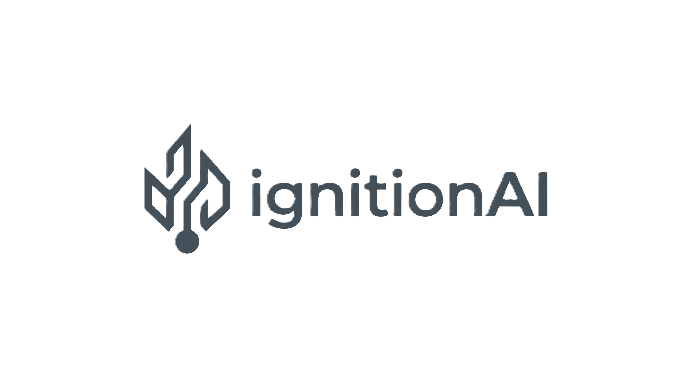

<div align="center">



# IgnitionAI

**AI-Powered Vehicle Diagnostics**

[](https://python.org)
[](https://doc.qt.io/qtforpython/)
[](https://ai.google.dev/)
[]()

> Scan OBD-II fault codes → ML analysis → Gemini AI plain-English diagnosis → PDF report

</div>

---

## 📐 Architecture Overview

```
IgnitionAI (Monorepo)
├── desktop/          ← PySide6 Windows App (Python)
│   ├── main.py       ← Entry point
│   └── app/
│       ├── config.py         ← API keys & theme (from config.example.py)
│       ├── data/
│       │   ├── dtc_database.py   ← 35+ OBD-II fault codes database
│       │   └── simulator.py      ← Virtual OBD simulator (6 scenarios)
│       ├── engine/
│       │   ├── diagnostic.py     ← Two-part ML pipeline
│       │   └── gemini_ai.py      ← Gemini AI integration
│       └── ui/
│           ├── splash.py         ← Branded splash screen
│           ├── main_window.py    ← Sidebar navigation
│           ├── dashboard.py      ← Home/stats screen
│           ├── scan_panel.py     ← Scan input + OBD simulator toggle
│           ├── results_panel.py  ← DTC rankings + anomaly chart
│           ├── ai_panel.py       ← AI diagnosis + repair narrative
│           └── report.py         ← PDF report generator
├── mobile/           ← Flutter Android App (coming Week 2)
├── backend/          ← FastAPI backend (coming Week 2)
└── simulator/        ← Standalone Virtual OBD server (coming Week 3)
```

---

## 🚀 Quick Start

### Prerequisites
- Python 3.12+
- pip

### Setup (Desktop App)

```bash
# 1. Clone the repo
git clone https://github.com/shankscodz/IgnitionAI.git
cd IgnitionAI/desktop

# 2. Install dependencies
pip install -r requirements.txt

# 3. Configure API key
cp app/config.example.py app/config.py
# Open app/config.py and add your Gemini API key

# 4. Run the app
python main.py
```

> **Get a Gemini API key free at:** https://aistudio.google.com/app/apikey

### Using the Virtual OBD Simulator
No physical car needed! On the **Scan** screen, click **"🎮 OBD Simulator"** and pick a fault scenario (e.g., "🔥 Random Misfire Engine"). The app will auto-populate realistic sensor data and run the full analysis pipeline.

---

## 🧠 How the Diagnostic Engine Works

```
OBD Scan (DTCs + PIDs)
        │
        ▼
┌─────────────────────────────────────┐
│         Part 1: Rule Engine          │
│  DTC → Sensor Plausibility Scoring  │
│  → Ranked DTCs → Ranked Root Causes │
│             (Answer A)               │
└─────────────────────────────────────┘
        │
        ▼
┌─────────────────────────────────────┐
│       Part 2: Anomaly Detection      │
│  IsolationForest / Z-score scoring  │
│  → Reverse-correlate DTCs           │
│             (Answer B)               │
└─────────────────────────────────────┘
        │
        ▼
┌─────────────────────────────────────┐
│      Decision Fusion (A vs B)        │
│   Consensus / DecisionTree / Rule   │
│   → Final Root Cause + Confidence   │
└─────────────────────────────────────┘
        │
        ▼
┌─────────────────────────────────────┐
│         Gemini AI Layer              │
│  Plain-English Diagnosis             │
│  Repair Narrative + PDF Report       │
└─────────────────────────────────────┘
```

---

## 🌿 Branching Strategy

| Branch | Purpose |
|--------|---------|
| `main` | Production-ready, protected. Only merged via approved PRs. |
| `dev` | Integration branch. All feature branches merge here first. |
| `feature/<name>/<description>` | Active development. e.g., `feature/intern1/bayesian-engine` |
| `hotfix/<description>` | Emergency fixes that go directly to `main`. |

**Workflow:**
```
feature/yourname/your-feature → dev → (review) → main
```

---

## 🤝 Contributing (Interns)

### First-Time Setup
1. Accept the GitHub repository invitation (Shashank will invite you)
2. Clone the repo: `git clone https://github.com/shankscodz/IgnitionAI.git`
3. Create your feature branch: `git checkout -b feature/<your-name>/<feature-name> dev`
4. Set up your config: `cp desktop/app/config.example.py desktop/app/config.py` and add your API key
5. Install deps: `cd desktop && pip install -r requirements.txt`

### Before Every PR
- [ ] Code runs without errors
- [ ] No `config.py` with real API keys committed
- [ ] Branch is up to date with `dev` (`git rebase dev`)
- [ ] Commit messages follow the format below

### Commit Message Format
```
type(scope): short description

Examples:
feat(engine): add Bayesian confidence updater
fix(ui): resolve splash screen freeze on startup
docs(readme): update setup instructions
refactor(simulator): extract scenario loader to separate module
```

### Pull Request Rules
- All PRs must target `dev` (never `main` directly)
- At least **1 approval** from Shashank required to merge
- CI checks (linting) must pass

---

## 🗺️ Roadmap

### ✅ Week 1 (MVP — Done)
- [x] PySide6 desktop app with dark blue theme
- [x] Two-part ML diagnostic pipeline
- [x] Built-in Virtual OBD Simulator (6 scenarios)
- [x] Gemini AI integration (diagnosis + repair narrative)
- [x] PDF report export
- [x] GitHub repository setup

### 🔄 Week 2 (Current Sprint)
- [ ] Offline SQLite storage (Drift)
- [ ] Vehicle picker & session management
- [ ] Backend: FastAPI + PostgreSQL skeleton
- [ ] DTC knowledge base expansion (100+ codes)

### 📅 Week 3
- [ ] Rule-based Diagnostic AI Engine (Module A)
- [ ] Flutter mobile app — Scan + Results screens

### 📅 Week 4–8
- [ ] Bayesian Confidence Updater (Module B)
- [ ] Mechanic feedback loop
- [ ] LLM reasoning for low-confidence sessions
- [ ] Web analytics dashboard
- [ ] Production APK + Play Console

---

## 📦 Dependencies

| Package | Purpose |
|---------|---------|
| `PySide6` | Desktop GUI framework |
| `matplotlib` | Sensor anomaly charts |
| `numpy` | Numerical computations |
| `scikit-learn` | IsolationForest anomaly detection |
| `google-genai` | Gemini AI SDK |
| `reportlab` | PDF report generation |

---

## 📁 Important Files

| File | Description |
|------|-------------|
| `desktop/app/config.example.py` | ⚠️ Template — copy to `config.py` before running |
| `desktop/app/data/dtc_database.py` | OBD-II DTC database (add new codes here) |
| `desktop/app/data/simulator.py` | Add new simulation scenarios here |
| `desktop/app/engine/diagnostic.py` | Core ML pipeline logic |
| `desktop/app/engine/gemini_ai.py` | AI prompt engineering |

---

## ⚠️ Security Rules

> **NEVER commit `config.py` with a real API key.**  
> The `.gitignore` is configured to ignore it, but always double-check before pushing.  
> If you accidentally push a key, revoke it immediately at https://aistudio.google.com and generate a new one.

---

## Telemetry diagnostic engine (v0.1)

The durable signal-processing engine is in `serving/diagnostics/`. It normalizes
real CSV/JSON OBD logs, derives combustion, fuel, thermal, load-response, and
charging virtual sensors, then fuses only available signals into a Vehicle
Health Index and evidence-backed candidate list. It is exercised against real
Opel and winter-condition OBD logs, not a fabricated dashboard feed.

All PID aliases, windows, thresholds, and VHI weights are configurable in
`serving/diagnostics/config/defaults.json`. Missing PIDs return
`insufficient_data`; they are never zero-filled or faked. `VirtualSensorOutput`
and `FaultDiagnosis` are persisted through the FastAPI schema when an analysis
is associated with a diagnostic session.

Gemini is only an optional final reporting endpoint. It receives `{ VHI,
fault_candidates }` after fusion, never raw telemetry. Put its key in the local
server environment using `serving/.env.example`; do not commit it. Demo-only
fault injection belongs in a separately labeled `demo/` package and has not
been added to the core engine.

---

<div align="center">
<sub>Built with ❤️ by the IgnitionAI team</sub>
</div>
